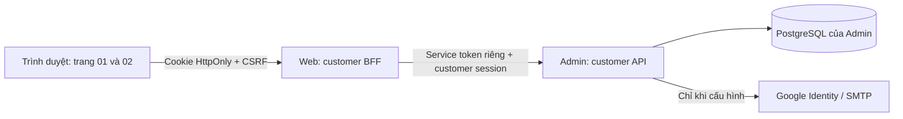

# Trang 01–02: tài khoản và Workspace

**Trang 03, 28/10/2026:** đã có quản lý khách hàng/thương hiệu, chọn khách hàng
đang làm việc và checklist dựa trên DB; migration 11 bổ sung metadata/selection.
Xem [Customer Overview](CUSTOMER_OVERVIEW.md) cho contract, quyền và kiểm thử.

**Docker 27/10/2026:** Customer Web, Customer Admin API và PostgreSQL đã có Compose
riêng, giữ origin 8084 và database hiện có; không còn cần tiến trình Admin trên
Windows. Xem [chạy/cập nhật/backup Docker](CUSTOMER_DOCKER.md). Các lệnh chạy hai
terminal bên dưới là phương án chạy trực tiếp phục vụ phát triển.

**Bổ sung 27/10/2026:** Trang 03 `/workspace` đã có Tổng quan thật và hướng dẫn
spotlight 8 bước. Tạo/chọn/tham gia Workspace chuyển sang trang này. Tiến độ tour
lưu trong migration 10 theo tài khoản + Workspace. Xem
[CUSTOMER_PRODUCT_TOUR.md](CUSTOMER_PRODUCT_TOUR.md) cho trạng thái mới;
các kết quả kiểm thử ngày 26/10 bên dưới là ghi nhận lịch sử.

Cập nhật 26/10/2026. Hai trang đã có FE, BFF, API Admin và DB thật, được bật bằng
`CUSTOMER_AUTH_ENABLED=true`. Đây là nền móng tài khoản/Workspace, chưa phải toàn bộ
hành trình kết nối nền tảng và đọc dữ liệu Marketing.

## Đã triển khai

- `/workspace/login`: đăng ký email/mật khẩu, đăng nhập, nhớ phiên, hiện/ẩn mật khẩu,
  đăng xuất, trạng thái lỗi; đăng nhập Google qua authorization code + PKCE; xác minh
  email và đặt lại mật khẩu qua liên kết dùng một lần khi có SMTP.
- `/workspace/onboarding`: tạo Agency/Doanh nghiệp, quốc gia, tiền tệ, múi giờ,
  website, khách hàng/thương hiệu đầu tiên tùy chọn; bước xem lại; danh sách và chọn
  Workspace; tạo mã mời và tham gia đúng email đã xác minh.
- Tạo Workspace và owner membership trong một transaction; request key chống tạo
  trùng khi gửi lại; reload/đăng nhập lại đọc dữ liệu từ DB. Tài khoản tối đa 20
  Workspace tự tạo; role Workspace không cấp quyền VIO Admin.
- Sau khi tạo/chọn/tham gia Workspace, chuyển sang Tổng quan `/workspace` và tour
  hướng dẫn. Trang 04–09 chưa mở đầy đủ trong luồng thật; các mục đang phát triển
  được giải thích rõ, không trỏ sang bản preview.
- Google/SMTP chưa cấu hình thì UI thông báo đúng trạng thái. Không có đăng nhập
  giả, tài khoản mặc định, tự động xác minh email hay số liệu Marketing mẫu.

## Ownership và vị trí dữ liệu



Web không mở kết nối DB và không nhận token Google. Admin giữ toàn bộ danh tính,
quyền, trạng thái và secret. Migration **9 — customer_identity_and_workspaces**
thêm các bảng dưới đây, không sửa bảng/revision/snapshot cũ:

| Bảng | Dữ liệu |
|---|---|
| `customer_accounts` | Email, tên, scrypt password hash, xác minh/hoạt động |
| `customer_identities` | Liên kết Google theo issuer + subject duy nhất |
| `customer_sessions` | SHA-256 của token ngẫu nhiên, hạn dùng, Workspace đang chọn |
| `customer_workspaces` | Organization/Workspace, cấu hình, chủ tạo, request key |
| `customer_memberships` | Thành viên và role theo Workspace |
| `customer_clients` | Khách hàng/thương hiệu thuộc Workspace |
| `customer_invitations` | Hash mã mời, email, role, hạn dùng và trạng thái |
| `customer_email_actions` | Hash liên kết xác minh/đặt lại mật khẩu dùng một lần |
| `customer_oauth_transactions` | Hash state/nonce, browser binding, PKCE verifier mã hóa |
| `customer_rate_limits` | Giới hạn đăng nhập/đăng ký/email và yêu cầu theo IP |
| `customer_audit_events` | Sự kiện đăng nhập, Workspace, lời mời, khôi phục tài khoản |

`customer_clients` chưa ánh xạ sang `clients`/`connections` của pipeline cũ. Chưa
cấp cho customer quyền đọc KinderHealth, VIO sandbox, Dataset, Bundle hoặc provider
API. Trang kết nối sau này phải bổ sung mapping và kiểm tra Workspace/Client ở mọi
connection, asset, sync và dataset; không lấy client ID từ trình duyệt làm quyền.

## Chạy bản thật ở local

Từ `D:\VioAgencyAnalytics`, cài dependencies theo lock của Admin và requirements
của Web nếu chưa có, sau đó:

```powershell
.\VioAgencyAnalytics-Admin\.venv\Scripts\python.exe VioAgencyAnalytics-Web/scripts/customer_dev.py init
```

Mở hai terminal và chạy lần lượt:

```powershell
.\VioAgencyAnalytics-Admin\.venv\Scripts\python.exe VioAgencyAnalytics-Web/scripts/customer_dev.py admin
.\VioAgencyAnalytics-Web\.venv\Scripts\python.exe VioAgencyAnalytics-Web/scripts/customer_dev.py web
```

- Đăng nhập: <http://127.0.0.1:8084/workspace/login>.
- Thiết lập: <http://127.0.0.1:8084/workspace/onboarding> (cần đăng nhập).
- Admin API riêng: `127.0.0.1:8094`, không chạy worker Marketing.
- PostgreSQL riêng: `127.0.0.1:5434`, DB `vio_customer`, container
  `vio-customer-postgres-dev`, volume bền vững `vio-customer-pg-data`.
- Cấu hình riêng và key ngẫu nhiên: `.work/customer-dev/config.json`, Git ignored.
  Không đưa file này vào source control hoặc gửi lên chat. Khởi động lại vẫn dùng
  cùng DB/key. Không xóa volume nếu cần giữ tài khoản/Workspace.
- Bản thiết kế 9 trang cổng 8083 vẫn dùng `app.design_preview:app`; không có login
  thật và không đọc DB kể cả khi biến bật customer auth được đặt.

Launcher không chỉnh `.env`, image/container cũ hoặc DB báo cáo hiện có. Production
chưa rollout: cờ mặc định false ở cả hai ứng dụng.

## Cấu hình triển khai

| Biến | Ứng dụng | Ý nghĩa |
|---|---|---|
| `CUSTOMER_AUTH_ENABLED` | Cả hai | Mặc định false; true để mở phần tài khoản |
| `CUSTOMER_SERVICE_TOKEN` | Cả hai | Key riêng giống nhau, ít nhất 32 ký tự ngẫu nhiên |
| `CUSTOMER_WEB_ORIGIN` | Cả hai | Origin Web chính xác, HTTPS ngoài loopback, không dấu `/` cuối |
| `CUSTOMER_BACKEND_URL` | Web | Origin Admin private, HTTPS ngoài loopback |
| `CUSTOMER_GOOGLE_CLIENT_ID/SECRET` | Chỉ Admin | OAuth client dành riêng cho customer identity |
| `CUSTOMER_SMTP_HOST/PORT` | Chỉ Admin | SMTP server; mặc định port 587 |
| `CUSTOMER_SMTP_USERNAME/PASSWORD` | Chỉ Admin | Tài khoản gửi email |
| `CUSTOMER_SMTP_TLS` | Chỉ Admin | Mặc định true, STARTTLS kiểm tra chứng chỉ |
| `CUSTOMER_EMAIL_FROM` | Chỉ Admin | Địa chỉ gửi email |
| `DATABASE_URL`, `ENCRYPTION_KEY` | Chỉ Admin | DB và Fernet key bền vững hiện có |

Google callback đăng ký chính xác là
`CUSTOMER_WEB_ORIGIN/auth/customer/google/callback`; local hiện tại:
`http://127.0.0.1:8084/auth/customer/google/callback`. Chỉ xin `openid email profile`.
Không tự liên kết tài khoản Google với tài khoản mật khẩu/Admin dựa trên email;
nếu trùng email, yêu cầu dùng phương thức đã đăng ký. Không dùng credential OAuth
Marketing hiện có cho identity.

### Bật Google Sign-in local

1. Mở [Google Auth Platform Clients](https://console.cloud.google.com/auth/clients), chọn hoặc tạo **một Google Cloud project mới dành riêng cho VioAgencyAnalytics Customer Identity**. Không dùng OAuth client đang cấp quyền GA4/GSC/Marketing.
2. Ở **Branding**, tạo app `VioAgencyAnalytics`; chọn email hỗ trợ và email liên hệ. Ở **Audience**, chọn `External` nếu cho người ngoài Google Workspace dùng. Khi app còn Testing, thêm email Google của bạn trong **Test users**.
3. Ở **Data Access**, giữ phạm vi định danh tối thiểu `openid`, `email`, `profile`. Không thêm Drive, Analytics, Search Console hay bất kỳ scope Marketing nào ở đây.
4. Ở **Clients**, bấm **Create client** → chọn **Web application**. Thêm đúng một Authorized redirect URI cho local:

   ```text
   http://127.0.0.1:8084/auth/customer/google/callback
   ```

   Không thêm dấu `/` cuối. Không cần Authorized JavaScript origin vì ứng dụng dùng authorization-code flow phía server, không dùng Google JavaScript client.
5. Lưu lại **Client ID** và **Client secret**; Google chỉ hiển thị secret một lần. Đừng gửi hai giá trị này qua chat hoặc commit vào Git.
6. Trong PowerShell ở `D:\VioAgencyAnalytics`, chạy lệnh sau và dán hai giá trị tại máy. Khi dán secret, terminal không hiển thị ký tự nào là bình thường:

   ```powershell
   .\VioAgencyAnalytics-Admin\.venv\Scripts\python.exe VioAgencyAnalytics-Web/scripts/customer_dev.py configure-google
   ```

7. Khởi động lại hai tiến trình `customer_dev.py admin` và `customer_dev.py web`, sau đó tải lại `/workspace/login`. Nút Google sẽ được bật. Đăng nhập bằng một email đã thêm trong Test users, xác nhận consent, rồi trình duyệt quay về trang thiết lập Workspace.

Google yêu cầu redirect URI trùng tuyệt đối với URI đã khai báo; thay đổi có thể mất vài phút đến vài giờ để có hiệu lực. Với domain production, tạo **OAuth client riêng** và dùng HTTPS, redirect URI đúng domain; không đưa `127.0.0.1` vào client production. Xem [hướng dẫn tạo OAuth client của Google](https://support.google.com/cloud/answer/15549257) và [hướng dẫn consent screen](https://developers.google.com/workspace/guides/configure-oauth-consent).

Thiết kế dựa trên [Google OpenID Connect](https://developers.google.com/identity/openid-connect/openid-connect)
và [google-auth ID token verification](https://google-auth.readthedocs.io/en/latest/reference/google.oauth2.id_token.html),
đọc ngày 26/10/2026. Chữ ký JWT được thư viện xác minh; backend kiểm tra issuer,
audience, azp, expiry, email_verified, nonce, state, browser binding và chống replay.
PKCE verifier lưu mã hóa; token Google không lưu cho mục đích Marketing.

Không log query callback, body mật khẩu, token phiên hoặc mã email; launcher Web
tắt access log. Reverse proxy production cũng cần loại query callback khỏi log.
IP throttle sử dụng peer thực của ASGI; chỉ cấu hình proxy headers từ proxy đáng tin
trong deployment. Không tin `X-Forwarded-For` tùy ý từ browser.

### Bật SMTP Gmail / Google Workspace local

1. Bật Xác minh 2 bước cho tài khoản Gmail gửi thư, rồi mở
   [Mật khẩu ứng dụng](https://myaccount.google.com/apppasswords), tạo mục
   `VioAgencyAnalytics SMTP`. Google có thể không cho tạo mật khẩu ứng dụng nếu
   tài khoản thuộc tổ chức bị hạn chế, chỉ dùng khóa bảo mật hoặc có Advanced Protection.
   Xem [hướng dẫn Google](https://support.google.com/accounts/answer/185833).
2. Từ `D:\VioAgencyAnalytics`, chạy:

   ```powershell
   .\VioAgencyAnalytics-Admin\.venv\Scripts\python.exe VioAgencyAnalytics-Web/scripts/customer_dev.py configure-smtp
   ```

   Host `smtp.gmail.com`, cổng `587` (Enter để dùng mặc định). Username là địa chỉ
   Gmail đầy đủ; From dùng cùng địa chỉ đó. Dán mật khẩu ứng dụng khi được hỏi
   (nhập ẩn), không dùng mật khẩu Google hoặc OAuth Client Secret.
   Lệnh kiểm tra STARTTLS và đăng nhập trước khi lưu; lỗi thì giữ nguyên cấu hình cũ.
   Cấu hình nằm trong `.work/customer-dev/config.json` đã được Git ignore.
3. Gửi một email kiểm tra bằng lệnh sau và nhập email nhận của bạn:

   ```powershell
   .\VioAgencyAnalytics-Admin\.venv\Scripts\python.exe VioAgencyAnalytics-Web/scripts/customer_dev.py test-smtp
   ```

   SMTP chấp nhận thư chưa chứng minh thư đã vào Inbox; kiểm tra cả Spam.
   Hai lệnh cấu hình/kiểm tra SMTP không yêu cầu PostgreSQL đang chạy.
4. Mở Docker Desktop, chạy `customer_dev.py init` nếu container DB chưa chạy,
   khởi động lại customer Admin và Web bằng các lệnh ở phần chạy local.
   Thử **Quên mật khẩu** với tài khoản đã đăng ký bằng email/mật khẩu; thử
   **Gửi email xác minh** trong Workspace với tài khoản email chưa xác minh.
   Tài khoản đăng nhập Google đã có email được Google xác minh nên không cần bước này.

Liên kết email local trỏ tới `127.0.0.1:8084`; mở trên máy đang chạy Web.
Production cần cấu hình `CUSTOMER_WEB_ORIGIN` là domain HTTPS thật.
Chưa coi SMTP đã bật hoặc email đã gửi thực tế cho đến khi người vận hành nhập
credential và hoàn thành các bước kiểm tra trên.

## Phiên và giới hạn

Cookie host-only `vio_customer_session`, HttpOnly, SameSite=Lax, Secure trên HTTPS.
Không ghi password/token vào localStorage/sessionStorage. Phiên thường hết hạn
server sau 8 giờ; ghi nhớ 30 ngày. Logout thu hồi server; đổi mật khẩu thu hồi mọi
phiên. Mọi POST yêu cầu JSON, Origin đúng và CSRF HMAC gắn với cookie trình duyệt.
Các GET riêng tư đều no-store. Service API không nhận cookie Admin làm quyền.

Lời mời có hạn 7 ngày, đúng email đã xác minh, dùng một lần. Owner được mời admin;
admin chỉ được mời member/viewer; role không nâng từ payload tùy ý. Mã được tạo để
chủ Workspace tự gửi; chưa có email lời mời tự động. Xác minh/reset có hạn 30 phút;
raw token nằm trong fragment URL email và được xóa khỏi thanh địa chỉ ngay khi đọc.

SMTP/Google live acceptance cần credential hợp lệ. Các test provider dùng transport
giả lập và JWT ký thật, không tuyên bố đã đăng nhập tài khoản Google thật. Billing,
provider consent, sync, dashboard và báo cáo customer không thuộc hai trang này.

## Kiểm thử và rollback

Kết quả local 26/10/2026:

| Bộ kiểm tra | Kết quả |
|---|---|
| Web toàn bộ | 337 PASS |
| Admin frontend | 102 PASS |
| Customer identity SQLite/PG + dry-run migration trên bản sao | 21 PASS |
| Platform migration regression SQLite/PG sau cập nhật kỳ vọng version 9 | 12 PASS |
| Browser desktop/mobile | 12 ảnh, không lỗi JavaScript, không tràn ngang |
| Syntax JS, pip check Admin, git diff --check | PASS (Git có cảnh báo chuẩn hóa CRLF) |

Lượt Admin đầy đủ chạy 583 bài: 531 PASS, 50 SKIP do cần guarded PostgreSQL
acceptance runner riêng, 2 FAIL vì test cũ cố định danh sách migration đến version 8.
Đã cập nhật kỳ vọng thành version 9 và chạy lại trọn module liên quan: 12 PASS.
Sau khi bổ sung kiểm tra cạnh tranh thu hồi phiên/đổi mật khẩu và dry-run migration,
toàn bộ nhóm customer mới chạy lại 21 PASS. Không tuyên bố đã chạy lại toàn bộ
583 bài sau thay đổi này; các lỗi tìm thấy đã được kiểm tra lại ở module tương ứng.

- Admin: `tests/test_customer_identity.py` chạy cùng hành vi trên SQLite và schema
  PostgreSQL dùng riêng; auth, revocation, tenant denial, replay, concurrent create,
  email và signed JWT verification.
- `tests/test_customer_migration.py`: backup DB fixture ở migration 8, nâng lên 9,
  so count/SHA-256 **từng bảng legacy**, chạy lại migration để kiểm tra idempotency.
- Web: `tests/test_customer_auth.py` kiểm tra cookie, CSRF, Origin, feature gate,
  allowlist BFF, outage, callback, giới hạn payload và preview isolation.
- `scripts/check_customer_identity_ui.py`: đăng ký/đăng nhập/đăng xuất, tạo/chọn,
  reload, cookie và layout ở 1440/390 px. Tạo account QA có tên rõ trong DB local;
  kết quả và ảnh ở `.work/customer-identity-qa/`, không có mật khẩu trong kết quả.
- Chạy suite Admin đầy đủ với schema PG dùng riêng qua
  `customer_dev.py test-admin`; launcher đặt fixture scope KinderHealth, tắt customer
  ở các test cũ và không truyền DATABASE_URL dev cho test SQLite.

Rollback ứng dụng bằng `CUSTOMER_AUTH_ENABLED=false` ở cả hai phía và restart.
Giữ bảng migration 9 để bảo toàn dữ liệu; không down-migrate/drop bảng. Trước rollout
vào DB thật cần backup/restore rehearsal trên bản sao của DB đó; fixture migration
test không thay thế kiểm tra dữ liệu production.
