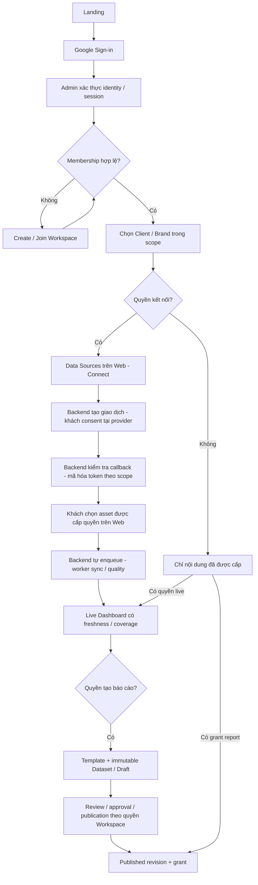

# VioAgencyAnalytics — Customer Workspace UX

**Triển khai tiếp ngày 26/10/2026:** trang 01–02 có customer identity, phiên, Workspace,
membership và lời mời trên DB, bật riêng bằng feature flag. Google/SMTP cần cấu hình;
các trang dữ liệu Marketing tiếp tục nằm trong kế hoạch. Xem
[phạm vi và nghiệm thu](CUSTOMER_IDENTITY_IMPLEMENTATION.md).

**Cập nhật 26/10/2026:** đã triển khai bộ giao diện 9 trang theo HTML người dùng cung
cấp và đưa báo cáo cũ vào Phân tích kênh. Xem [phạm vi triển khai UI](CUSTOMER_UI_IMPLEMENTATION.md).
Các phần dưới đây vẫn mô tả kiến trúc backend đích; giao diện xem thử không có nghĩa
Google login, Organization, OAuth hay đồng bộ self-service đã hoạt động.

Ngày 23/10/2026, bổ sung rà soát customer-first sau rebrand. **Thiết kế mục tiêu, chưa phải các màn hình/routes SaaS đang hoạt động.** VIO Agency phát triển, sở hữu và vận hành VioAgencyAnalytics. Web hiện chủ yếu hiển thị Published Bundle theo Viewer grant do backend kiểm tra; demo/design preview và preview nội bộ không phải customer Live Dashboard.

Tài liệu nền: [Product Vision](../../VioAgencyAnalytics-Admin/docs/VIOAGENCYANALYTICS_PRODUCT_VISION.md), [Architecture](../../VioAgencyAnalytics-Admin/docs/VIOAGENCYANALYTICS_ARCHITECTURE.md), [Roadmap](../../VioAgencyAnalytics-Admin/docs/SAAS_MIGRATION_ROADMAP.md). Các liên kết giả định hai repository nằm cạnh nhau.

## Current State và Target State

Hiện `app/routes/viewer.py:admin_selection` chuyển `/`, `/login`, `/reports` về Admin; `main.py:production_reports_only` giới hạn trang production, và `dashboard_context` dựng giao diện từ Bundle. Provider OAuth/chọn asset/sync bên Admin yêu cầu role nội bộ `admin`. Đây là luồng tương thích đang có, không phải onboarding self-service đã hoàn thành. Cờ `content_live` ở mapper không có nghĩa là customer Live Dashboard đã tồn tại.

Mục tiêu: khách bắt đầu và hoàn thành công việc trên **VioAgencyAnalytics-Web**. Đăng nhập → Workspace → Client/Brand → Data Sources → OAuth → asset → sync → dashboard → reports/sharing. Backend tự xử lý nghiệp vụ; khách không phải tới VIO Super Admin hoặc nhờ nhân viên VIO kết nối nguồn/tạo báo cáo. Chỉ bước consent/identity chuyển trình duyệt tới nhà cung cấp chính thức.

## Nguyên tắc trải nghiệm

- Dùng tên **VioAgencyAnalytics** và thể hiện VIO Agency là chủ sở hữu; tên Client/Brand là dữ liệu khách hàng, không thay bằng tên sản phẩm.
- Workspace là tên trên UI của Organization ở MVP, 1:1; Agency có nhiều Client/Brand. Switch Workspace phải tải lại scope/quyền và dữ liệu, không giữ nhầm state từ Workspace trước.
- Google Sign-in đăng nhập ứng dụng; kết nối Google/Meta/TikTok là consent dữ liệu riêng. Không hỏi mật khẩu provider hoặc copy token vào form.
- Backend quyết định quyền; ẩn/disable nút chỉ là trợ giúp UX. Web không đọc provider API, không nhận provider secrets.
- Mọi Connect/Reconnect/Disconnect bắt đầu từ Web. VIO Super Admin cấu hình ứng dụng tích hợp cấp hệ thống; Organization Admin quản lý nguồn của Workspace mình. Hai vai trò này không thay thế nhau và VIO không mặc định được xem dữ liệu khách.
- Hiển thị trạng thái có thật; không dùng số liệu mẫu lấp empty/error/partial. “Đã kết nối” không đồng nghĩa “đã có dữ liệu”, và “đã đồng bộ” không đồng nghĩa “đã duyệt/phát hành”.

## Hành trình và màn hình

| Bước | Nội dung/hành động | Điều kiện và đầu ra |
|---|---|---|
| Landing/Login | Giới thiệu phân tích/báo cáo; nút Đăng ký/Đăng nhập bằng Google; liên kết điều khoản/quyền riêng tư khi được chuẩn bị | Flow identity riêng; không tự xin scope Marketing. Cancel/error quay lại login, không tạo thông báo thành công giả. |
| Create/Join Workspace | Tạo tên Organization/Workspace hoặc chấp nhận invite; chọn Workspace nếu đã có nhiều membership | Backend kiểm tra invite đúng người/phạm vi/hạn dùng; không tự join theo email domain. |
| Customer onboarding | Checklist tạo/chọn Client/Brand → kết nối → chọn asset → sync → dashboard | Có thể lưu tiến độ/tiếp tục; bước chưa có quyền hướng dẫn liên hệ Organization Admin, không đổi role tự động. |
| Data Sources / Integrations | Facebook Content, Meta Ads, GA4, GSC hoặc nguồn được hỗ trợ; trạng thái supported/planned, kết nối và phạm vi quyền | Connect chỉ cho người có quyền; Web xin authorization URL từ backend, consent tại provider chính thức và callback về backend. Backend kiểm tra giao dịch/quyền, lưu token mã hóa theo Organization/Client/Connection; UI chỉ nhận trạng thái an toàn. MVP ưu tiên Facebook Content. |
| Select Source Asset | Danh sách property/site/Page/Ad Account có quyền; tên, ID hiển thị cần thiết, currency/timezone, Client/Brand đích | Khách chọn rõ ràng; backend kiểm tra lại quyền/ownership, lưu lựa chọn và tự enqueue initial sync. Không tự chọn asset đầu tiên, không chờ nhân viên VIO bấm Sync. |
| Sync Progress | Khoảng ngày, queued/running, lần cập nhật, nguồn xong/lỗi, retry khi được phép | Không báo phần trăm nếu backend không có tiến độ đáng tin; trạng thái tồn tại sau reload; request lặp không tạo job trùng. |
| Dashboard | Tự hiện dashboard theo nguồn có dữ liệu; khách tùy chỉnh KPI/chart, date/comparison, source/Client/Brand selector, as-of/coverage/freshness | Đọc dữ liệu đã đồng bộ từ Admin scoped API qua quality gate tự động; không cần phát hành report trước; nguồn thiếu không hiển thị KPI bằng 0. |
| Report Builder | Chọn template version, Dataset/period, sections, ghi chú, preview, gửi review | Preview từ Dataset bất biến, không gọi provider; lưu draft khác gửi review; stale approval cần duyệt lại. |
| Reports | Draft/awaiting review/published theo quyền, provisional/final, revision, export/cấp/thu hồi chia sẻ cho Client Viewer | Người xem chỉ thấy published được cấp; mở revision chính xác, không đổi sang mới nhất khi link revision cũ không hợp lệ. Export cũng kiểm tra quyền; gửi báo cáo theo lịch ở giai đoạn sau. |
| Workspace Settings | Thành viên/vai trò/invite, Client/Brand, connections, audit; billing/white label sau | Org Admin không thành VIO Super Admin; customer không thấy token, service credentials hoặc thông số hạ tầng. |

## Hai chế độ có tên và hành vi khác nhau

**Live Dashboard** hiển thị dữ liệu đồng bộ mới nhất đạt chất lượng phù hợp, không yêu cầu duyệt/phát hành thủ công. Chỉ hiển thị KPI có cơ sở dữ liệu hợp lệ; thiếu số liệu phải là null/trạng thái rõ ràng. Luôn có “Dữ liệu đến…”, “Đồng bộ lúc…”, timezone và coverage. Filter/so sánh chỉ áp dụng cho phần dữ liệu có sẵn. Nếu chưa có API SaaS và isolation thì chưa mở chế độ này cho customer. “Làm mới dữ liệu” là yêu cầu job riêng có quyền, không phải GET dashboard gọi provider.

**Published Report** hiển thị Bundle bất biến theo report ID/revision được cấp. Nhãn provisional là “Tạm thời”, final là “Chính thức” theo contract. Đổi ngày/filter chỉ lọc phần snapshot được hỗ trợ, không lấy dữ liệu live hoặc sửa kỳ công bố. Quyền xem report không cấp quyền xem dashboard live. Customer không vào internal preview chỉ bằng cách biết candidate ID.

## Loading, empty và lỗi

| Trạng thái | Hiển thị | Hành động đúng quyền |
|---|---|---|
| Loading identity/scope | Đang xác thực / đang tải Workspace | Chờ hoặc retry; không giữ dữ liệu Workspace trước. |
| Không có Workspace | Create/Join hoặc chờ lời mời | Tạo nếu policy cho phép; không tự cấp membership. |
| Chưa kết nối nguồn | Giải thích nguồn được hỗ trợ và lợi ích | Connect cho người có quyền; Viewer liên hệ quản trị. |
| Connected, chưa chọn asset | Kết nối thành công, cần chọn tài sản | Select asset; không hiện dữ liệu mẫu. |
| Provider không có asset được cấp | Không tìm thấy tài sản trong quyền hiện có | Kiểm tra tài khoản/quyền, reconnect; không hứa tạo tài sản bên provider. |
| Queued/running | Thời điểm bắt đầu, nguồn đang xử lý | Xem tiến độ; retry bị khóa nếu job đang chạy. |
| Empty sau sync | Không có bản ghi trong kỳ | Đổi kỳ trong coverage, kiểm tra asset; không đồng nghĩa lỗi API. |
| Partial/stale | Nêu nguồn/ngày thiếu và lần thành công cuối | Cho xem phần hợp lệ, giữ null và cảnh báo; không bật publication trái policy. |
| Missing comparison | Không đủ kỳ so sánh | Ẩn tỷ lệ tăng/giảm hoặc ghi chưa khả dụng; không tính từ zero giả. |
| Revoked/expired consent | Cần kết nối lại | Chỉ người có quyền reconnect; Published Report cũ vẫn theo grant, không bị sửa nội dung. |
| Unsupported/planned platform | Chưa hỗ trợ tích hợp | Không có nút kết nối giả hoặc thu mật khẩu/token. |
| Session expired | Phiên hết hạn | Đăng nhập lại, chỉ quay lại đường dẫn nội bộ được cho phép. |
| Access denied/no grant | Không có quyền xem nội dung này | Xin quyền qua quy trình dự kiến; không tiết lộ tên/dữ liệu tenant khác. |
| Bundle/revision missing | Báo cáo không khả dụng | Về danh sách đã được cấp; không tự chuyển revision khác. |
| Server/rate-limit error | Thông báo ngắn và mã hỗ trợ đã lọc | Retry có backoff; không hiện raw provider response, token hoặc stack trace. |

## Permission flow

Các mũi tên không cấp quyền: Admin kiểm tra mỗi request và job. Reviewer/Publisher là capability riêng; Viewer không tự có quyền draft/export mọi nguồn. Thu hồi membership/grant phải làm request tiếp theo bị từ chối và UI xóa state liên quan. VIO support access phải có policy/audit riêng.

Reviewer/Publisher là thành viên Workspace có quyền theo policy, không mặc định là nhân viên VIO. Customer không thấy token hoặc phải nhập password Marketing; reconnect quay lại consent chính thức. Disconnect ngừng đồng bộ mới, cho biết trạng thái revoke, giữ revision đã phát hành theo grant; dashboard dữ liệu cũ chỉ còn hiển thị khi policy cho phép và phải có nhãn freshness/reconnect.

## Lát cắt UX MVP đầu tiên và phần phải xây

**Google Sign-in → Workspace → Client/Brand → Connect Facebook Content VIO → chọn Page → Sync tự động → Dashboard thật.** Sau lưu Page, Web đi tới Sync Progress; reload vẫn thấy job đang chạy, khi có dữ liệu thì chuyển/mở dashboard. Trường hợp partial/stale hiển thị phần hợp lệ cùng cảnh báo; không chuyển khách tới màn hình chờ nhân viên VIO duyệt report. Tên VIO Page chỉ là pilot có cấp quyền, không là Page mặc định cho mọi Workspace.

Xây mới login/onboarding/Workspace switcher và quản lý Client/Brand/thành viên; Data Sources và connection lifecycle; asset selector; sync progress; dashboard live đọc API có tenant scope và cấu hình/filter/comparison. Tái sử dụng layout, chart, null/quality presentation và Published Bundle renderer hiện có với contract phù hợp. Xây customer template picker/Report Builder/preview/export/sharing sau MVP live; giữ Viewer revision/grant và compatibility. Billing/white label và scheduled delivery theo Roadmap sau.

Sandbox VIO chỉ phục vụ nghiệm thu sandbox có provenance rõ ràng; không dùng số liệu, token hay thông tin cấu hình sandbox làm dữ liệu production. Nếu production chưa có consent/asset/sync riêng, UI hiển thị onboarding/empty đúng trạng thái.

## Acceptance cho implementation sau

Onboarding hoàn thành trên hai Organization cách ly với cùng một user có role khác nhau; switching Workspace không rò state. Google login không tự connect nguồn. Cancel/denied OAuth, expired invite, sync empty/partial/failed, stale data, no comparison, revoked membership/grant và wrong revision có trạng thái dễ hiểu. Keyboard/focus/loading announcements và responsive desktop/mobile được kiểm tra. Không có provider credential trong HTML/JS/network responses của Web. Published Bundle cũ render đúng null, coverage, provisional và revision sau khi bật UX mới.

MVP còn phải chứng minh khách hoàn thành toàn hành trình trên Web mà không có VIO thao tác thay; chọn Page tự sync không tạo job trùng khi retry; dashboard có dữ liệu hợp lệ dù chưa có Published Report; account/asset sai scope bị chặn. Không dùng sandbox PASS làm nghiệm thu production.

Lượt rà soát này chỉ cập nhật tài liệu kiến trúc/UX. Không thêm nút self-service, route/session/grant hoặc code SaaS; chỉ triển khai sau khi người dùng thống nhất và chấp thuận kiến trúc.
